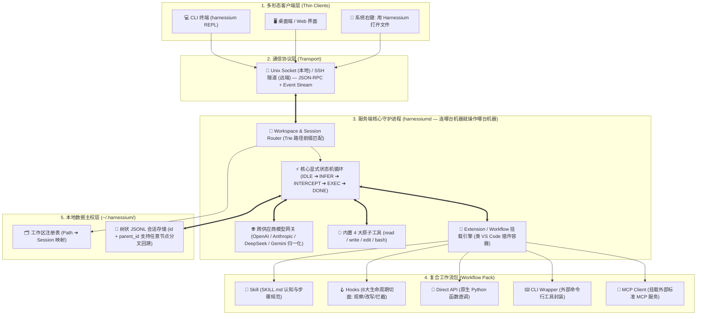

# 🏛️ Harnessium 产品原型与系统架构蓝图 (Living Blueprint v0.2)

> **定位**：AI Agent 领域的 Chromium —— 本地优先、主从解耦、去黑盒的通用智能体执行微内核。  
> **架构作者**：Xiaokang Zhao (赵晓康)  
> **当前所处阶段**：`[阶段 2: 先驱解剖与扩展体系设计]` $\longrightarrow$ `[阶段 3: 核心原语与数据结构定义]`

---

## 🗺️ 一、全景大结构图（The Big Picture Architecture）

*(注：已修复 Mermaid 子图连线悬空 Bug，全部改为具体节点直连)*

---

## 🧭 二、硬核软件从 0 到 1 诞生的 5 阶段路线图

- [x] **阶段 1：痛点锚定与拓扑定型（Vision & Topology）**
  - 确立命名 `Harnessium`；确立 `harnessiumd` 守护进程 + 多瘦客户端分离架构；确立“连哪台机器就操作哪台机器”的远程边界。
- [x] **阶段 2：先驱解剖与扩展体系设计（Benchmarking & Extension Architecture）** *(👈 当前推进点)*
  - 吸收 `Pi` 的树状会话与分层纪律、吸收 `dsh` 的可逆挂载与拦截器；提出超越单一 Skill 的 **复合扩展包（Extension / Workflow Pack）** 机制。
- [ ] **阶段 3：核心原语与数据结构定义（Primitives & Data Contracts）**
  - 定义 `TurnNode`（会话树节点）、`AgentEvent`（通信事件）、`ExtensionManifest`（五合一扩展包清单）核心数据结构。
- [ ] **阶段 4：状态机流转与异常边界推演（State Machine & Failure Modes）**
  - 推演 Hook 拦截链路、工具超时、用户中途打断（Ctrl+C）、审批挂起等状态转换。
- [ ] **阶段 5：最小可用垂直切片实现（Vertical Slice MVP）**
  - 落地 `harnessium/core/`、`harnessium/daemon/`、`harnessium/clients/` 初版代码。

---

## ✅ 三、核心架构决策日志（Confirmed Architectural Decisions）

| 编号 | 决策维度 | 确立方案 | 架构落点 |
| :--- | :--- | :--- | :--- |
| **D1** | **代码库三大模块** | `core/`（状态机与网关） + `daemon/`（服务端与路由） + `clients/`（CLI/GUI/右键脚本） | 严格单向依赖：`core` 不感知网络，`daemon` 包装 `core` 暴露 Socket，`clients` 只负责收发事件与渲染。 |
| **D2** | **OS 右键打开体验** | **方案 A**：弹出轻量终端/面板，自动定位工作区并挂载该文件，光标就绪等待用户指令 | `harnessium open <filepath>` 通过 Trie 树匹配最近工作区，自动挂载文件元信息进入会话树。 |
| **D3** | **远程操作边界** | **连哪台机器的 `harnessiumd`，手脚就在哪台机器**（类 VS Code Remote-SSH） | 免去复杂的跨机文件同步；ACI 工具永远在 `harnessiumd` 所在宿主机的沙箱内直接执行。 |
| **D4** | **会话分支回溯** | **必选刚需（Session Branching）** | 采用 `id + parent_id` 的追加式 JSONL 存储，支持任意历史节点 checkout / fork 新分支。 |
| **D5** | **复合扩展机制** | 正式定名 **`Workflow Pack`（工作流包）**，采用渐进式复杂度设计 | 最简可仅含 1 个 `SKILL.md`；进阶可按需组合 `Skill + Hook + Direct API + CLI Tool + MCP`，将传统软件工程确定性实践迁移至 Agent。 |

---

## ❓ 四、当前待讨论问题池（Open Questions for Next Iteration）

1. **Hook 切入点的取舍**：在导学梳理的 **6 大生命周期切入点**（`on_mount`、`before_turn`、`before_tool`、`after_tool`、`before_finish`、`on_unmount`）以及 **3 种干预权力**（旁路观察、数据改写、一票否决）中，你觉得初版内核全保留，还是先上最核心的 4 个？
2. **进入【阶段 3：核心原语与数据结构定义】**：理解完 Hook 机制后，我们是否可以开始拉出 `TurnNode`（会话树节点）、`AgentEvent`（前后端通信事件）、`WorkflowPack`（工作流包与 Hook 签名）这三个核心数据结构？
