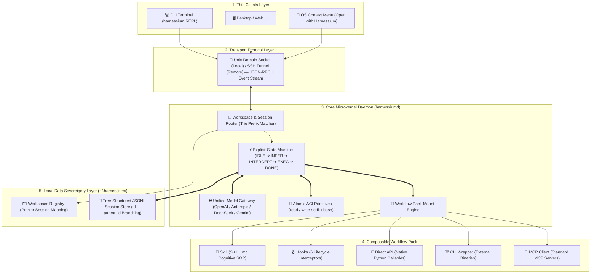

# 🧬 Agent Microkernel (`Harnessium`)

> **A minimal, decoupled, local-first Agent Microkernel & Runtime with 100% workflow and data sovereignty.**
>
> 拒绝“连地基都没有的玩具框架”，也拒绝“过度封装、捆绑私货的商业黑盒”。将确定性运行时与业务逻辑彻底解耦，把工作流与数据主权 100% 交还给开发者与专业用户。

---

## 💡 Motivation: Why an Agent Microkernel?

Current LLM agent frameworks typically fall into two extremes:
1. **Fragile Toy Wrappers**: Thin prompt loops lacking workspace routing, process isolation, session branching, or lifecycle interception.
2. **Opaque Monolithic Blackboxes**: Heavyweight commercial harnesses with puluhan-page hidden system prompts, vendor lock-in, and coupled UI/execution state.

**Agent Microkernel (`Harnessium`)** takes a third path inspired by operating system microkernels and `VS Code Remote` architecture:
- **Strict Client-Daemon Separation**: A deterministic background daemon (`harnessiumd`) manages the explicit agent state machine, model gateway, and sandboxed ACI tools, while thin clients (CLI REPL, GUI, OS context-menu hooks) communicate purely over IPC/SSH event streams.
- **Zero Blackbox & Data Sovereignty**: All system prompts, tree-structured session logs (`id + parent_id` append-only JSONL), and workspace bindings live locally in plain text under `~/.harnessium/`.
- **Progressive Workflow Packs**: Bridges deterministic software engineering and probabilistic LLM reasoning by packaging `Skill.md + Lifecycle Hooks + Direct Python API + CLI Wrappers + MCP` into hot-swappable units.

---

## 🗺️ Architecture Overview

---

## ✅ Core Architectural Decisions

| ID | Dimension | Architectural Choice | Engineering Rationale |
| :--- | :--- | :--- | :--- |
| **D1** | **Three-Tier Module Boundary** | `core/` (State Machine & Gateway) + `daemon/` (IPC & Routing) + `clients/` (CLI/GUI/OS Hooks) | Strict unidirectional dependency: `core` is network-agnostic; `daemon` wraps `core` over Unix Socket; `clients` only render events and send intents. |
| **D2** | **OS-Level Context Integration** | `harnessium open <filepath>` via Trie workspace prefix matching | Right-clicking any file in the OS file manager locates the nearest registered workspace and mounts file metadata directly into the active session tree. |
| **D3** | **Remote Execution Boundary** | **"Connect to where `harnessiumd` lives"** (VS Code Remote-SSH model) | Eliminates brittle cross-machine file syncing; the 4 atomic ACI tools (`read`/`write`/`edit`/`bash`) always execute natively inside the target host's sandbox. |
| **D4** | **Non-Destructive Session Branching** | Append-only JSONL with `id + parent_id` pointers | Enables instant `checkout` / `fork` from any historical turn in a conversation without mutating prior context trajectories. |
| **D5** | **Composable Extension Model** | Progressive **`Workflow Pack`** specification | Scales smoothly from a single zero-code `SKILL.md` file up to a full bundle with deterministic pre/post-tool lifecycle hooks and native APIs. |

---

## 🧩 Composable Workflow Packs & Lifecycle Hooks

Unlike rigid agent frameworks that force everything into either natural-language prompts or heavy MCP servers, `Harnessium` introduces **6 deterministic lifecycle hook points** (`on_mount`, `before_turn`, `before_tool`, `after_tool`, `before_finish`, `on_unmount`) with three intervention levels:
1. **Observe (Read-Only Telemetry)**: Audit token usage, latency, and tool trajectories without altering state.
2. **Mutate (Context & Payload Rewriting)**: Dynamically prune stale context, inject environment variables, or sanitize tool outputs.
3. **Veto (Deterministic Guardrails)**: Block dangerous shell commands or out-of-policy tool calls at the microkernel boundary before execution.

---

## 🧭 Roadmap

- [x] **Phase 1: Topology & Boundary Definition** — Established `harnessiumd` daemon + thin-client IPC topology and remote execution semantics.
- [x] **Phase 2: Extension & Lifecycle Architecture** — Designed the 5-in-1 `Workflow Pack` container and 6-stage lifecycle hook interceptor pipeline.
- [ ] **Phase 3: Core Primitives & Data Contracts** — Formalizing `TurnNode` (tree JSONL schema), `AgentEvent` (IPC wire protocol), and `ExtensionManifest`.
- [ ] **Phase 4: State Machine & Failure Recovery** — Handling mid-turn cancellation (`SIGINT`), tool timeouts, and human-in-the-loop approval suspension.
- [ ] **Phase 5: Vertical Slice MVP** — Shipping reference implementations of `harnessium/core/`, `harnessium/daemon/`, and dogfooding workflows (Academic Literature Distillation & Multi-Platform Media Publishing).

Detailed architectural notes: [BLUEPRINT.md](BLUEPRINT.md) · [PLAN.md](PLAN.md)
